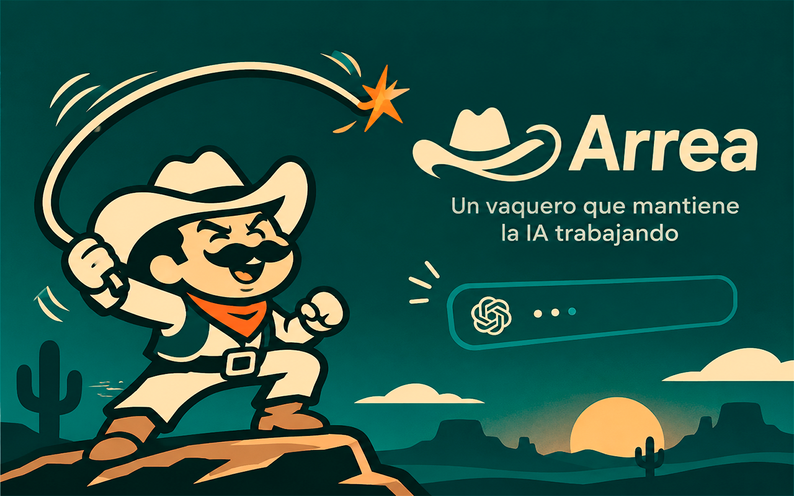

  

<h1 align="center">Arrea</h1>

<strong>Un vaquero para las esperas de ChatGPT, Gemini y Claude.</strong>

Arrea es una extensión de Chrome que anima la espera mientras un chat genera una respuesta. El vaquero empieza con latigazos tranquilos, acelera poco a poco y, si la espera se alarga, da paso a alguna escena especial. Los efectos son visuales y se ejecutan en el navegador.

## Qué puedes hacer

- **Lanzar escenas con clic derecho.** Elige **Arrea: abrir acciones** para probar el Mega Ultra Giga, que cruza casi toda la pestaña, un duelo a caballo, los refuerzos y otros efectos.
- **Mantener a los refuerzos durante las respuestas.** Activa **Llamar refuerzos** y aparecerán mientras el chat trabaja. Se retiran al terminar la respuesta y vuelven con la siguiente hasta que desactives la opción.
- **Colocar al vaquero donde quieras.** Arrástralo o muévelo con **Mayús + flechas** cuando tenga el foco. Arrea guarda la posición por servicio.
- **Ajustar ritmo, sonido y bocadillos.** Desde el icono de la extensión también puedes seleccionar **Probar las escenas** para ver la demo sin iniciar sesión.

## Instalación local

1. Descarga el repositorio desde **Code → Download ZIP** y descomprímelo, o clónalo con Git.
2. Abre `chrome://extensions` y activa **Modo de desarrollador**.
3. Pulsa **Cargar descomprimida** y selecciona la carpeta que contiene `manifest.json`.
4. Abre o recarga una pestaña de ChatGPT, Gemini o Claude.

Si actualizas los archivos, pulsa **Recargar** en la tarjeta de Arrea y vuelve a cargar la pestaña del chat.

## Privacidad

Arrea comprueba si el botón de detener la respuesta está visible y procesa esa señal en el navegador. Los ajustes se guardan en `chrome.storage.local`. La extensión no lee el contenido de los mensajes ni lo envía a servidores. [Política de privacidad de Arrea](https://nheu.cat/arrea/privacidad/)

## Desarrollo

La extensión usa Manifest V3, JavaScript y Canvas, y se carga directamente desde `manifest.json`. El código de detección y del menú dentro del chat está en `overlay.js`. Las escenas se dibujan en `animation.js` y el menú contextual de Chrome se registra en `background.js`.
